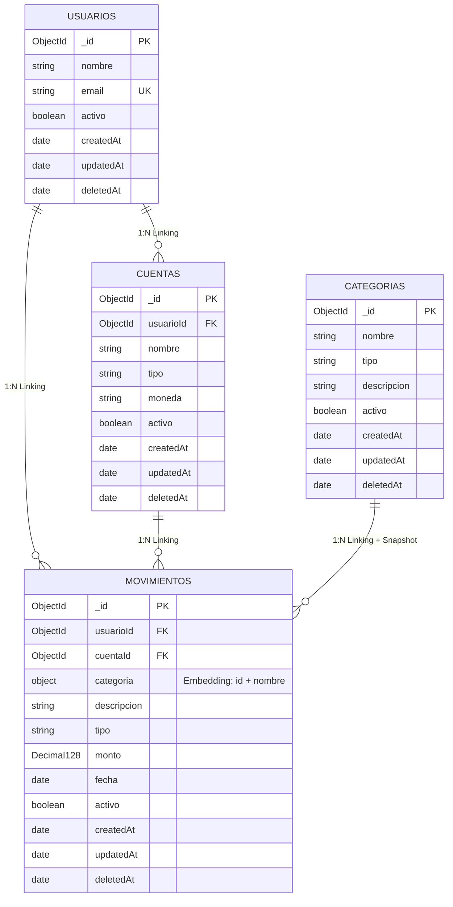

# Modelo de datos — Gestión de Finanzas Hogareñas

El sistema utiliza cuatro colecciones MongoDB. Las relaciones se implementan mediante referencias (`ObjectId`); la categoría de un movimiento incorpora además una copia histórica de su nombre (*snapshot*).

## Decisiones de modelado

- **Linking:** `usuarioId` y `cuentaId` referencian documentos independientes. `categoria.id` referencia una categoría dentro del subdocumento embebido.
- **Embedding:** `movimientos.categoria` contiene `{ id, nombre }` para preservar el nombre histórico usado al registrar el movimiento.
- **Baja lógica:** todas las colecciones utilizan `activo` y `deletedAt`; no se eliminan documentos físicamente.
- **Importes:** `Decimal128` evita los problemas de precisión binaria de `double` para dinero.
- **Identificadores:** MongoDB genera automáticamente `_id` de tipo `ObjectId`.

> **Nota:** `PK`, `FK` y `UK` son anotaciones conceptuales del diagrama. MongoDB no impone claves foráneas; la aplicación valida las referencias. La unicidad de `email` requiere un índice único.
